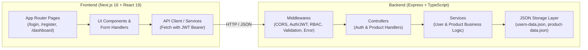

# ARCHITECTURE.md – Application Architecture & Design

## 1. High-Level Architecture

CloudOrder follows a decoupled client-server architecture:



---

## 2. Directory Structure

```text
cloudorder/
├── AGENTS.md                  # Mandatory AI rules and instructions
├── PROJECT_CONTEXT.md         # Project background, goals, and tech stack
├── ARCHITECTURE.md            # Architecture, system design, and folder layout
├── CODING_STANDARDS.md        # Code quality, naming, and engineering rules
├── REQUIREMENTS.md            # Tracked functional & non-functional requirements
├── TASKS.md                   # Development tasks backlog & execution progress
├── CHANGELOG.md               # Historical record of changes and validations
├── backend/
│   ├── src/
│   │   ├── config/            # Centralized environment configuration
│   │   │   └── index.ts
│   │   ├── controllers/       # HTTP request handlers
│   │   │   ├── auth.controller.ts
│   │   │   └── product.controller.ts
│   │   ├── middlewares/       # Security, validation, and error middlewares
│   │   │   ├── auth.middleware.ts       # authenticate (JWT) & authorize (RBAC)
│   │   │   ├── auth-validate.middleware.ts # DTO validation for auth
│   │   │   ├── validate.middleware.ts   # Product payload validation
│   │   │   └── error.middleware.ts      # Global 404 & 500 handlers
│   │   ├── routes/            # Route declarations
│   │   │   ├── auth.routes.ts
│   │   │   └── product.routes.ts
│   │   ├── services/          # Business logic & persistence operations
│   │   │   ├── user.service.ts
│   │   │   └── product.service.ts
│   │   ├── types/             # TypeScript domain models and DTOs
│   │   │   ├── express.types.ts
│   │   │   ├── user.types.ts
│   │   │   └── product.types.ts
│   │   ├── app.ts             # Express application setup
│   │   └── server.ts          # Server bootstrap
│   ├── product-data.json      # Product data file
│   ├── users-data.json        # User credentials (bcrypt hashed)
│   ├── .env                   # Local backend configuration
│   ├── .env.example
│   ├── tsconfig.json
│   └── package.json
└── frontend/
    ├── app/                   # Next.js App Router (pages & layouts)
    │   ├── layout.tsx
    │   ├── page.tsx
    │   └── globals.css
    ├── public/                # Static assets
    ├── next.config.ts
    ├── tsconfig.json
    ├── eslint.config.mjs
    └── package.json
```

---

## 3. Backend Architectural Patterns

- **Layered Architecture**: Clear separation between Transport Layer (Routes & Controllers), Business Logic Layer (Services), and Data Layer (File I/O).
- **Service-Oriented Logic**: Controllers never manipulate JSON files directly; all query and mutation logic is encapsulated in `product.service.ts` and `user.service.ts`.
- **Stateless Authentication**: Authentication utilizes signed JSON Web Tokens (`Bearer <token>`). Tokens encapsulate `userId`, `email`, and `role`.
- **Role-Based Access Control (RBAC)**:
  - `authenticate`: Validates JWT token integrity and expiration, attaching the payload to `req.user`.
  - `authorize(allowedRoles)`: Gates execution to authorized roles (`admin`, `user`).
- **Standardized Error Handling**: Unhandled exceptions bubble up to `errorHandler` in `error.middleware.ts`, delivering consistent JSON error responses:
  ```json
  {
    "success": false,
    "message": "Error description",
    "errors": [] // Optional field validation errors
  }
  ```

---

## 4. Frontend Architecture (Planned & Ongoing)

- **Next.js App Router**: Utilizing route groups `(auth)` for `/login` and `/register`, and `(dashboard)` for product catalog and admin management views.
- **Client Services**: Dedicated HTTP API client wrapping `fetch` with token storage (HTTP-only cookie or secure local storage) and automatic error handling.
- **Role-Aware Navigation**: Dynamic navigation menus showing admin tools (Add Product, Delete Product) only when the authenticated user role is `admin`.
